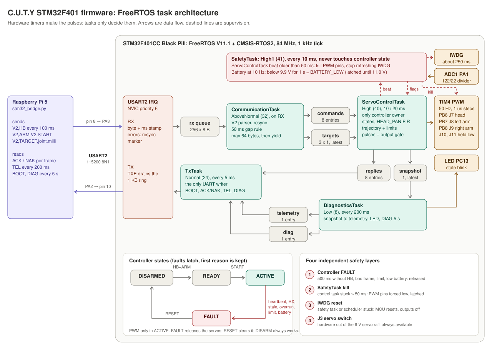

# FreeRTOS motion firmware (STM32F401 Black Pill)



The STM32 firmware in [`stm32/`](../stm32/README.md) is a complete, buildable FreeRTOS
image for the STM32F401CC Black Pill on the carrier v1.1. The Raspberry Pi sends
high-level goals over USART2; the STM32 owns trajectories, limits, PWM and safety for
the three active joints: HEAD_PAN (J7), LEFT_ARM (J8) and RIGHT_ARM (J9). J10 and J11 are
reserved and held low.

## Status: what is proven and how

| Layer | Evidence | Not covered |
| --- | --- | --- |
| Portable core (parser, controller, FIR, battery, liveness, wire records) | Host unit tests: `make test-host` | — |
| Task topology on the real FreeRTOS V11.1 kernel | FreeRTOS POSIX simulator scenario test: `make test-sim` | Cortex-M timing |
| Cortex-M4F image: startup, vector table, ARM_CM4F port, NVIC, USART2 RX/TX IRQs | QEMU `netduinoplus2` (STM32F405 model): `make test-qemu` | F401 clock tree, TIM4, ADC, IWDG (not modelled) |
| Raspberry bridge ↔ firmware | `raspberry/tests/test_stm32_bridge.py` against the simulator | Real UART wiring |
| F401 clocks, TIM4 PWM, ADC, IWDG, carrier wiring, servos | **Not yet validated on hardware.** Follow the bring-up below | — |

The default `make` builds a **dry-run image**: every task runs and telemetry reports what
would be commanded, but the PWM pins never leave GPIO-low. `make PWM=1` builds the image
that can drive servos, and only after the Pi sends `HB`, `ARM` and `START`.

## Tasks

Hardware timers generate every pulse; tasks only decide the next pulse width. CMSIS-RTOS2
priorities are passed straight to FreeRTOS (higher number = higher priority).

| Task | Priority | Activation | Stack (bytes) | Free stack seen* | Responsibility |
| --- | --- | --- | --- | --- | --- |
| USART2 IRQ | NVIC 6 | each byte | MSP | — | Timestamp RX bytes into the RX queue; UART errors and overflow become a resync marker; TXE drains the 1 KiB TX ring |
| SafetyTask | High1 (41) | every 10 ms (absolute) | 1024 | 832 | Supervise ServoControlTask's beat (≤ 50 ms) → refresh IWDG or kill PWM; battery ADC at 10 Hz |
| ServoControlTask | High (40) | 10 ms poll, 20 ms trajectory step | 1536 | 1188 | Only owner of controller state: state machine, freshness/barriers, HEAD_PAN FIR, damped trajectory, limits, pulses + output gate, snapshot |
| CommunicationTask | AboveNormal (32) | RX queue, ≤ 64 bytes then yield | 1536 | 1092 | V2 parser; drops lines with lost/garbled bytes; 50 ms gap rule; latest-target mailbox per joint |
| TxTask | Normal (24) | every 5 ms | 1536 | 820 | Only UART writer: `BOOT`, `ACK`/`NAK`, `TEL`, `DIAG`, whole lines only |
| DiagnosticsTask | Low (8) | every 200 ms (absolute) | 1024 | 532 | Snapshot → telemetry (5 Hz), state LED, `DIAG` every 5 s |

\* Smallest free stack reported by `V2,DIAG` from the ARM image running in QEMU while all
three joints moved. TxTask was raised from 1024 to 1536 bytes after it showed only 252 bytes
free. Heap (heap_4, 24 KiB): 12.8 KiB never used.

Resources (all allocated before the scheduler starts; allocation failure is fatal):

| Queue | Depth | Producer → consumer | Overflow behaviour |
| --- | --- | --- | --- |
| rx | 256 × 8 B | IRQ → CommunicationTask | Byte lost, next byte flagged, line discarded, `RX` fault if armed |
| commands | 8 | CommunicationTask → ServoControlTask | `RX` fault |
| targets | 3 × 1 | CommunicationTask → ServoControlTask | Overwritten: latest goal per joint wins |
| replies | 8 | ServoControlTask → TxTask | Counted in `dropped` |
| snapshot | 1 | ServoControlTask → DiagnosticsTask | Overwritten (latest value) |
| telemetry, diag | 1 each | DiagnosticsTask → TxTask | Dropped, never blocks control |

ServoControlTask thread flags: `INVALID_RX`, `SUPERVISE`, `BATTERY_LOW`, `BATTERY_OK`.
No mutex is needed: the controller has a single owner and queues copy data.

## Safety layers

1. **Controller FAULT** (ServoControlTask): 500 ms without `HB`, malformed/garbled frame,
   stale command (> 100 ms), control overrun, trajectory limit or low battery. The first
   reason latches and is reported in `TEL`. Policy is `RELEASE_OUTPUT`: on FAULT the pins
   go low, so the servos get no pulses. This policy was chosen because the arms hang
   down at rest and the pan axis carries no gravity load. `RESET` clears the fault;
   `HB` + `ARM` + `START` re-arm.
2. **SafetyTask kill**: if ServoControlTask stops beating for more than 50 ms, SafetyTask
   forces the PWM pins low directly in the board layer. The kill is latched and does not
   depend on the stuck task.
3. **IWDG**: after a kill, or if SafetyTask itself or the scheduler stalls, nobody
   refreshes the independent watchdog. The MCU resets after about 250 ms (LSI tolerance
   170–470 ms) and boots with outputs disabled. `V2,BOOT,WATCHDOG,...` reports it.
   Fatal paths (assert, stack overflow, malloc failure, HardFault, MemManage, BusFault,
   UsageFault, NMI) also kill outputs first.
4. **J3 servo switch**: the hardware cut of the 6 V rail stays the final authority.

Battery (PA1, divider 122/22, filtered at 10 Hz): below 9.9 V (3.3 V/cell) for 1 s
latches `BATTERY`, which refuses `ARM` until a pack reads above 11.0 V for 2 s.
Readings below 5 V mean "no pack" (USB-only bench) and never inhibit.
Bench note: MG996R servos usually go limp without pulses, but some "digital" variants
hold their last position. Verify this on the real servos. The J3 switch is the reliable
cut.

**Enabling outputs:** `START` enables PWM at the last commanded position, which is
neutral (1500 µs) after boot. The servos then move from wherever they physically are
to neutral at their own speed. The assembly guide centres every servo at 1500 µs before
the horn, arm or head goes on, so neutral is the assembled rest pose. Keep hands clear
and the head facing forward before `START`. Pins switch between AF and GPIO only
between pulses, so enabling or releasing never emits a runt pulse.

## Wire protocol V2

115200 8N1, ASCII lines ending in LF (an optional CR before LF is accepted).

Raspberry → STM32 (unchanged grammar, max 63 bytes):

| Record | Meaning |
| --- | --- |
| `V2,HB` | Refresh the heartbeat. Send ≥ 2 Hz (the bridge sends 10 Hz) |
| `V2,ARM` | DISARMED → READY, needs a fresh heartbeat and no battery inhibit |
| `V2,START` | READY → ACTIVE, enables outputs |
| `V2,DISARM` | Inhibit outputs; FAULT stays latched |
| `V2,RESET` | FAULT → DISARMED |
| `V2,TARGET,<joint>,<milli>` | `HEAD_PAN`, `LEFT_ARM`, `RIGHT_ARM`; signed integer −1000..1000 = normalized −1..1 |

STM32 → Raspberry (new):

| Record | Meaning |
| --- | --- |
| `V2,BOOT,<reset>,<HSE\|HSI>,<sysclk_hz>,<DRYRUN\|PWM>` | Once after reset. `reset` = POWER, PIN, WATCHDOG, SOFTWARE, BROWNOUT, OTHER |
| `V2,ACK,<seq>,<cmd>[,<joint>]` / `V2,NAK,...` | Per valid frame; `seq` counts valid frames since boot |
| `V2,TEL,<ms>,<state>,<reason>,<out>,<head>,<left>,<right>,<battery_mv>,<rx_errors>,<dropped>` | 5 Hz. Positions are commanded milli-units, not measured. `out` is the physical PWM gate. Reasons: NONE, INVALID, RX, STALE, HEARTBEAT, OVERRUN, LIMIT, BATTERY |
| `V2,DIAG,<ms>,<com>,<srv>,<saf>,<dia>,<tx>,<heap_min>,<rx_ovf>,<tx_ovf>` | Every 5 s: free stack bytes per task, minimum free heap, overflow counters |

Malformed lines while DISARMED only count `rx_errors`. A booting Pi that prints to the
UART cannot latch a fault, but disable the Linux serial console on GPIO14/15 anyway
(`raspi-config` → Interface → Serial: login shell **no**, hardware **yes**). The link has
no CRC: a corrupted line that still parses would be accepted. This is acceptable on a
short on-board trace; add a checksum before using longer cables.

Raspberry side: [`cuty.hardware.stm32_bridge`](../raspberry/src/cuty/hardware/stm32_bridge.py)
parses every record, keeps the 10 Hz heartbeat and offers a bench console
(`python -m cuty.hardware.stm32_bridge --port /dev/serial0`). `head_follow.py` stays in
dry-run; connecting it to the bridge is a separate, reviewed step.

## Timing measured in the simulator

From `make test-sim` (FreeRTOS POSIX port; its tick runs at about 0.9× wall clock, so
wall-clock numbers are slightly pessimistic):

| Scenario | Result |
| --- | --- |
| Telemetry period (firmware clock) | exactly 200 ms |
| `TARGET` → `ACK` | 2–12 ms |
| HEAD_PAN 0 → 490 milli (FIR + damped trajectory, 0.8/s, 1.5/s²) | 3.3 s, monotonic, no overshoot |
| Malformed frame while ACTIVE → PWM released | 7–10 ms |
| Last `HB` → PWM released | 500–560 ms (500 ms timeout) |
| 9.5 V pack → `FAULT,BATTERY` | 2.7 s (filter settling + 1 s) |
| Stuck ServoControlTask → PWM killed | 65–75 ms (50 ms + safety period) |
| Stuck ServoControlTask → watchdog reset | about 310 ms |

## Build, test and flash

```bash
cd stm32
make                 # dry-run image: build/f401/cuty.{elf,bin,hex}
make PWM=1           # servo-driving image: build/f401-pwm/
make test            # host unit tests + FreeRTOS simulator scenario
make test-qemu       # ARM image in QEMU over USART2
make flash-dfu       # Black Pill USB DFU: hold BOOT0, tap NRST, release BOOT0
```

Toolchain: `arm-none-eabi-gcc` (the one inside STM32CubeIDE works; on Debian/Ubuntu
`apt install gcc-arm-none-eabi libnewlib-arm-none-eabi`), plus `qemu-system-arm` for
`test-qemu` and `dfu-util` for `flash-dfu`. STM32CubeProgrammer can also flash
`cuty.bin` at 0x08000000 over DFU, as in the assembly guide. Size today: about 20 KiB
flash, 30 KiB static RAM (including the 24 KiB FreeRTOS heap). Our sources build with
`-Wall -Wextra -Werror -Wshadow -Wdouble-promotion`.

Windows users without `make` can still run `python stm32/tests/run_host_tests.py` and
`python stm32/tests/compile_arm_objects.py --cc ... --cmsis stm32/Drivers/CMSIS/RTOS2/Include`.

## Bring-up on the real robot

Do the steps in order and record the result of each.

1. **Board check.** Read the chip marking (STM32F401CCU6), the Black Pill revision and the
   25 MHz crystal. `V2,BOOT` reports `HSE` when the crystal and PLL started, `HSI`
   otherwise.
2. **Dry-run image, servos unpowered (J3 off).** Flash `make`. On the Pi:
   `python -m cuty.hardware.stm32_bridge --port /dev/serial0`. Expect `BOOT` and `TEL`
   at 5 Hz, then `arm`, `start` and `pan 0.5`. Telemetry should show HEAD_PAN rising to
   500 with `out=0`. Check that the battery reading matches a multimeter at the XT60
   within ±0.2 V.
3. **Fault drills, still dry-run.** Quit the console (heartbeat stops): `FAULT,HEARTBEAT`.
   Send a bad line: `FAULT,RX`. Pull the pack: telemetry battery drops to 0.
4. **PWM on the scope, J3 still off.** Flash `make PWM=1`. Probe PB6/PB7/PB8:
   nothing before `start`; then 50 Hz with a 1500 µs pulse; `pan 1` → 1900 µs; quit the
   console → the pin goes low within 0.6 s with no short pulse.
5. **One servo, no horn, J3 on.** HEAD_PAN only. Check direction and smoothness, and
   whether the servo goes limp on FAULT.
6. **Calibration.** In `stm32/App/servos/calibration.h`, adjust `min_us`/`max_us`/`reversed`
   per joint until ±1 matches the safe mechanical range. Keep the midpoint at the
   assembly centre (1500 µs) unless the mechanism was assembled off-centre.
7. **Full robot.** Head facing forward and arms hanging, then `arm` and `start`. Small
   targets first.

## Design references

- [ST RM0368 reference manual (STM32F401)](https://www.st.com/resource/en/reference_manual/rm0368-stm32f401xbc-and-stm32f401xde-advanced-armbased-32bit-mcus-stmicroelectronics.pdf)
- [FreeRTOS on Cortex-M: interrupt priorities](https://www.freertos.org/RTOS-Cortex-M3-M4.html)
- [ARM CMSIS-RTOS2 API](https://arm-software.github.io/CMSIS_6/latest/RTOS2/index.html)

The interactive FreeRTOS section on the website remains an educational visualization; it
is not connected to the firmware or to live telemetry.

## Web and DSP checks (unchanged)

```bash
cd web && npm run build && npm run lint && npm test && npm run test:e2e
```

If port 5173 is busy, set `CUTY_TEST_PORT` first. The HEAD_PAN FIR and the speech
band-pass are documented in [digital-signal-processing-fir.md](digital-signal-processing-fir.md).
