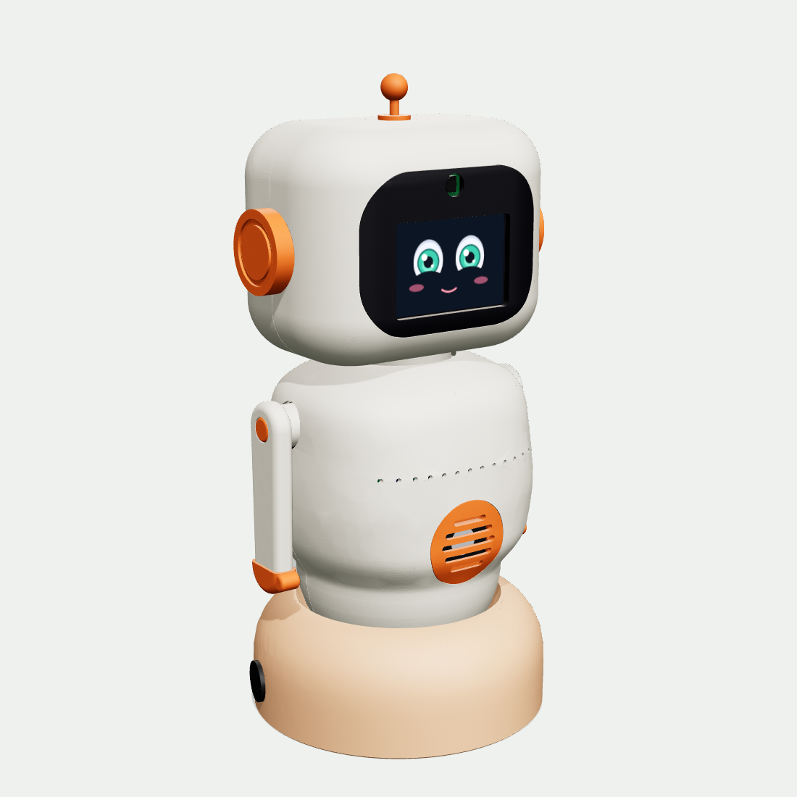

# C.U.T.Y · Carcasa V17 «Nido»

Robot compañero de 36 cm que se arma a mano como un set de bloques: 30 piezas impresas que encajan con clips, ranuras, una bayoneta y dos llaves (los brazos), sobre una base con gimbal de dos servos. Todo cabe en la cama de 180 × 180 mm de la Bambu A1 mini.



**Revisión 11 nov 2026:** la cubierta B1 se rediseñó para imprimirse bien: el borde de abajo ahora es un anillo plano de 2.2 mm (antes era redondeado y casi no tocaba la cama, por eso fallaba) y el techo de su hueco interior sube a 45°, así que ya no lleva soportes adentro. Solo necesita soportes bajo la orilla del agujero central y sobre la abertura del cajón. Ya no lleva la firma debajo de la base.

**Revisión 6 nov 2026:** con las medidas reales que tomó el equipo. H3 (visor) trae una cuna para la cámara (la sujeta por el contorno, así no importa dónde tenga los agujeros) y sus barras van a la medida de la pantalla de 5.8 mm. H4 suma una tercera barra para la cámara. S3 (rejilla) trae un bolsillo para la bocina rectangular de 35.4 × 25 × 5.5 mm. La batería es la LiPo 3S 2200 mAh 50C (HM2202) que ya tiene el equipo.

**Revisión 5 nov 2026:** ajustada a las piezas que sí se compraron y a la tornillería de los dos kits de Amazon. Cambiaron K5 (rack), B1, B2 y B3 (batería 3S hasta 109 mm), G2/G3 (manivelas con piso para el tornillo), B4 y K1 (ejes del gimbal con tornillo M4 autorroscante, sin tuerca), K1 y H3 (Pi y pantalla con M2) y H5 (servo de cabeza con M3). La guía paso a paso con fotos 3D está en la guía de armado de C.U.T.Y.

## Qué hay en esta carpeta

| Carpeta / archivo | Para qué sirve |
|---|---|
| `STL_imprimir/` | 30 STL listos para Bambu Studio, ya orientados para la cama. |
| `STEP_ensamble/CUTY_V17_Ensamble_completo.step` | Ensamble completo con colores, incluye placa, Pi 5, servos, batería, pantalla y cámara. Ábrelo en Fusion (Archivo › Abrir): entra como componentes. |
| `STEP_partes/` | Cada pieza en su posición final, para editarla en Fusion. |
| `CUTY_V17.glb` | Modelo 3D para visores web, presentaciones o Blender. |
| `renders/` | Frente, espalda, lado y rayos X. |
| `texturas/` | La cara real de `cuty.face` (feliz, tranquilo, escuchando, sorpresa) para renders. |
| `fuente_cad/` | El generador en CadQuery. Cambia una medida y reconstruye todo. |
| `partes.json`, `verificacion.json` | Medidas de impresión, volúmenes y resultados de la revisión de choques. |

## Arquitectura

- **Nido (base fija, Ø172 mm):** piso con bayoneta, cubierta tipo cojín con un plato cóncavo, cajón de batería trasero que corre en rieles, dos interruptores redondos y dos servos MG996R acostados que mueven el gimbal con manivelas y dos varillas con rótulas.
- **Gimbal:** junta universal (cruceta de 14 mm con dos tornillos M4 × 30 como ejes). El fondo del cuerpo es una esfera concéntrica al gimbal, así el robot "rueda" dentro del plato con 3.5 mm de holgura constante.
- **Núcleo:** plataforma, columna, hombros, rack de potencia y cubo del cuello. Toda la electrónica se atornilla aquí antes de poner la carcasa.
- **Carcasa:** panza y espalda se deslizan horizontalmente y muerden la plataforma con clips. Los brazos pasan por la costura y las amarran.
- **Cabeza:** casco en dos mitades, visor negro con pantalla y cámara, servo de giro adentro. Orejas y antena atraviesan la costura y la cierran.

## Imprimir

Capa 0.2 mm, 3 perímetros, 15 % de relleno giroide, PLA. Holguras de encaje de 0.2 mm. Izquierda y derecha se leen viendo al robot de frente.

| Código | Pieza | Color | Medida en cama (mm) | Cómo imprimir |
|---|---|---|---|---|
| B1 | Cubierta del nido | Durazno | 172 × 172 × 67 | Sobre su anillo plano · soportes árbol **solo desde la cama** · brim **solo interior** 5 mm |
| B2 | Piso del nido | Gris | 165 × 167 × 26 | Plano · sin soportes |
| B3 | Cajón de batería | Durazno | 119 × 63 × 30 | Sobre el fondo · sin soportes |
| B4 | Poste del gimbal | Gris | 40 × 40 × 88 | De pie, brida abajo |
| G1 | Cruceta | Gris oscuro | 14 × 14 × 14 | 100 % relleno |
| G2, G3 | Manivelas | Gris oscuro | 22 × 12 × 6 | Planas · 100 % relleno |
| K1 | Plataforma del núcleo | Gris | 124 × 118 × 47 | Boca abajo · soportes bajo la placa (5 mm) |
| K2 | Columna | Gris | 110 × 96 × 10 | Acostada |
| K3 | Hombros | Gris | 114 × 32 × 66 | Viga abajo |
| K4 | Cubo del cuello | Gris oscuro | 32 × 32 × 14 | Brida abajo · 100 % relleno |
| K5 | Rack de potencia | Gris | 38 × 55 × 44 | De lado · soportes mínimos |
| S1 | Panza | Crema | 148 × 162 × 76 | Sobre la costura · soportes solo en los clips |
| S2 | Espalda | Crema | 148 × 162 × 67 | Sobre la costura · soportes solo en los clips |
| S3 | Rejilla de la panza | Naranja | 55 × 55 × 14 | Marco de la bocina abajo · soportes árbol solo bajo el anillo |
| S4 | Tapón USB | Naranja | 8 × 13 × 12 | De lado |
| A1, A2 | Brazos | Crema | 104 × 30 × 22 | Cara exterior abajo · 4 perímetros |
| A3, A4 | Manos | Naranja | 16 × 34 × 14 | Cara exterior abajo |
| A5, A6 | Tapas de brazo | Naranja | 14 × 14 × 4 | Cara abajo |
| H1 | Casco frontal | Crema | 160 × 134 × 59 | Sobre la costura · soportes árbol mínimos |
| H2 | Casco trasero | Crema | 160 × 134 × 56 | Sobre la costura (el nombre queda arriba) |
| H3 | Visor | Negro | 121 × 93 × 11 | Cara abajo en PEI texturizado · soportes en las orillas |
| H4 | Barras de la pantalla y de la cámara | Gris | 85 × 87 × 3 | Planas (3 barras) |
| H5 | Base de la cabeza | Gris | 96 × 48 × 10 | Plana |
| H6, H7 | Orejas | Naranja | 46 × 46 × 22 | Cara exterior abajo |
| H8 | Antena | Naranja | 18 × 18 × 34 | De pie · soporte bajo la bolita |

Filamento aproximado (PLA, 15 % de relleno): crema ≈ 380 g, gris ≈ 200 g, durazno ≈ 175 g, naranja ≈ 50 g, negro ≈ 25 g, gris oscuro ≈ 10 g. Total ≈ 0.85 kg.

**Primero imprime una prueba:** G2 (manivela) y K4 (cubo del cuello). Si el spline de 25 dientes de tu MG996R entra muy duro o muy flojo, ajusta `spline_25t` en `fuente_cad/v17/common.py` y reconstruye.

## Tornillería

Todo sale de dos kits: **Taiss** (autorroscantes de cabeza redonda M2, M3 y M4) y el **kit M3 allen** (tornillos de máquina con tuercas). Los autorroscantes van en plástico; los allen van en el eje metálico de los servos.

| Cant. | Tornillo | Kit | Dónde |
|---|---|---|---|
| 33 | M3 × 10 autorroscante | Taiss | 16 en los 4 servos del cuerpo y del nido · 3 poste al piso · 4 rack a la columna · 4 base de la cabeza · 4 servo de cabeza · 2 rótulas a las manivelas |
| 7 | M3 × 8 autorroscante | Taiss | 4 placa C.U.T.Y a la columna · 3 cubo del cuello a la viga |
| 6 | M3 × 12 autorroscante | Taiss | 2 columna a plataforma · 2 hombros a columna · 2 rótulas a las patas |
| 2 | M4 × 30 autorroscante | Taiss | Ejes del gimbal (sin tuerca: se enroscan en la mejilla del fondo) |
| 4 | M2 × 8 autorroscante | Taiss | Raspberry Pi 5 |
| 6 | M2 × 10 autorroscante | Taiss | 4 barras de la pantalla · 2 barrita de la cámara |
| 2 | M3 × 8 allen | Kit M3 | Manivelas a los servos del nido |
| 2 | M3 × 12 allen | Kit M3 | Brazos a sus servos |
| 1 | M3 × 20 allen | Kit M3 | Desde abajo de la viga al servo de la cabeza |

Varillas del gimbal: 4 rótulas M3 Hobbypark y 2 tramos de varilla roscada M3 de unos 25 mm (córtala con segueta). Enrosca una rótula en cada punta hasta que los centros de los ojos queden a **49 mm**. Además: 4 topes de silicón bajo el piso.

## Piezas compradas para las que está diseñada

| Pieza | Medida que usa el modelo |
|---|---|
| Batería LiPo 3S 2200 mAh 50C (HM2202, la del equipo) | el cajón acepta hasta 109 × 35 × 25 mm; falta medirla |
| Buck XL4015 5 A (sin voltímetro) | 54 × 23 × 18 mm, de pie, bornes arriba |
| Convertidor JRBLVL 12→5 V 5 A, USB-C en cable | 46 × 32 × 18 mm, de pie, cables hacia abajo |
| 2 balancines redondos 12 V/20 A | agujero Ø20 mm |
| Cable de cámara Pi 5, 22→15 pines, 50 cm | pasa por la ranura trasera de la viga |
| Cable plano IDC de 40 vías hembra-hembra, 20 cm | J12 → Pi 5, por el lado derecho de la columna |
| Extensión XT60 macho-hembra, 30 cm | batería → J1, por el hueco del plato |
| Cable de silicón 16 AWG | J2/J3 → interruptores (35 cm por cable) y J4/J5 ↔ buck (15 cm por cable) |
| Raspberry Pi 5 | 90.3 × 56 × 18 mm medida (con puertos y micro SD) |
| Pantalla Display-G 3.5" | 85 × 55.3 × 5.8 mm medida, sin contar el conector de 26 pines |
| ReSpeaker 2-Mics HAT V2.0 | 65.5 × 29.8 × 11.5 mm medida |
| Cámara Arducam OV5647 | PCB 24.4 × 23.3 mm, 7.2 mm de fondo con el lente de 8.5 × 8.5 mm |
| Bocina 2 W 8 Ω | 35.4 × 25 × 5.5 mm medida, va acostada (35.4 a lo ancho) |
| 5 × MG996R | 40.7 × 19.7 × 37 mm (sin brackets ni placas de metal) |

La pantalla se conecta a J13 con cables Dupont (pasan por la ranura delantera de la viga). La MPU-6050 es opcional: si no la pones, su lugar en la plataforma queda vacío.

## Armado en 15 pasos

1. **Piso del nido.** Pega los 4 topes. Desliza los dos servos del gimbal acostados contra sus muros (eje hacia el centro) y atorníllalos (8 × M3 × 10). Centra cada servo a 90° y pon su manivela apuntando al centro con un M3 × 8 allen.
2. **Poste del gimbal.** Brida en el anillo del piso, 3 × M3 × 10 desde abajo. La ranura del tubo mira al frente.
3. **Varillas.** Arma las dos varillas a 49 mm entre centros. Atornilla la rótula de abajo a cada manivela (M3 × 10).
4. **Interruptores y cubierta.** Interruptores a presión en la cubierta (principal a la izquierda, servos a la derecha). Baja la cubierta sobre el piso, alinea las 3 pestañas y gira 14° hasta el clic.
5. **Cruceta.** Dentro de la horquilla del poste, M4 × 30 de adelante hacia atrás: pasa libre por la mejilla delantera y la cruceta y se enrosca en la trasera. Aprieta hasta que la cruceta gire sin juego.
6. **Plataforma.** Sobre la cruceta, el segundo M4 × 30 de izquierda a derecha. Atornilla las rótulas de arriba a las patas (M3 × 12).
7. **Columna y placa C.U.T.Y.** Columna en la ranura de la plataforma (2 × M3 × 12 desde abajo). Placa en los 4 postes del frente (M3 × 8).
8. **Raspberry Pi 5.** En los postes detrás de la columna (4 × M2 × 8). Conecta el cable plano de 40 vías a J12 y a la Pi.
9. **Rack de potencia.** XL4015 contra la columna (bornes arriba), convertidor de 5 V de pie en su repisa con sus cables hacia abajo por la ranura, rack a la columna con sus 4 orejas (M3 × 10 desde el frente de la columna). El USB-C del convertidor va a la Pi.
10. **Hombros y cuello.** Servos de brazo desde adentro (8 × M3 × 10), hombros arriba de la columna (2 × M3 × 12), cubo del cuello sobre la viga (3 × M3 × 8).
11. **Visor.** Pantalla de cara contra el visor dentro de sus costillas, dos barras (4 × M2 × 10). Cámara arriba: métela desde arriba entre sus dos guías, con el lente hacia la ventana redonda y el cable saliendo por abajo; pon la barrita sobre su espalda y apriétala (2 × M2 × 10) solo hasta que la cámara no se mueva.
12. **Cabeza.** Servo de cabeza en su base (4 × M3 × 10). Visor dentro del casco frontal, cierra con el trasero, presiona orejas y antena. 4 × M3 × 10 desde abajo. Monta la cabeza en el cubo y fija con M3 × 20 allen desde abajo de la viga. Deja una vuelta de cable de cámara y de Dupont para que la cabeza gire ±90°.
13. **Panza y espalda.** Bocina acostada en el bolsillo de la rejilla, cara hacia afuera, con 2 o 3 puntos de silicón en las esquinas; rejilla en la panza. Desliza panza y espalda hasta que los clips muerdan la plataforma. Tapón USB.
14. **Brazos.** Cada brazo por su agujero hasta el spline (M3 × 12 allen), tapas y manos a presión. Los brazos cierran el cuerpo.
15. **Batería.** Extensión XT60, desliza el cajón hasta el clic. Enciende el principal y luego el de servos.

## Límites de movimiento (ponlos en el firmware)

| Eje | Límite verificado |
|---|---|
| Cabeceo del gimbal | ±18° |
| Balanceo del gimbal | ±15° (a 18° las manos rozan el cojín) |
| Cabeceo + balanceo a la vez | ±14° / ±10° |
| Giro de cabeza | ±90° |
| Brazos | ±120° |

## Verificación (6 nov 2026, con las medidas reales del equipo)

- 30 piezas, cada una un sólido válido; STL herméticos.
- Todas caben en 180 × 180 × 180 mm (la cubierta B1 es la más grande: 172 × 172 × 67).
- 113 cuerpos (30 impresos y 83 comprados, incluidos los ejes M4 y los tornillos de las manivelas) revisados por pares con todo armado: 0 interferencias. Los contactos de superficies coincidentes se confirmaron en 0.000 mm³ con booleanas exactas.
- 18 zonas para cables y conectores (XT60, enchufes de servos, IDC, cables del convertidor, bornes del buck, ventilador de la Pi) libres de plástico.
- 34 posturas revisadas: gimbal, cabeza y brazos sin choques dentro de los límites de arriba.
- Largos de cable revisados en el modelo: extensión XT60 (≈20 cm de recorrido), cable plano de 40 vías (≈12 cm), cámara (≈30–35 cm con la vuelta del cuello), cables de servo (≤22 cm, los MG996R traen 30 cm), interruptores (≈26 cm de recorrido, se cortan de 35 cm).

## Antes de imprimir todo

Ya están medidas la Pi, la pantalla, el ReSpeaker, la cámara y la bocina. Faltan dos medidas: la batería (largo × ancho × alto) y, en la cámara, del borde de abajo de la placa al centro del lente (el modelo supone 13.7 mm). Si alguna cambia, ajusta `fuente_cad/v17/refs.py` y corre:

```
cd fuente_cad/v17
pip install cadquery==2.8.0 trimesh manifold3d
python3 build.py --rebuild     # reconstruye todas las piezas
python3 meshcheck.py           # revisa choques en reposo y en movimiento
python3 export.py              # STEP, STL orientados y ensamble para Fusion
```

Diseñado por APL en Guadalajara.
