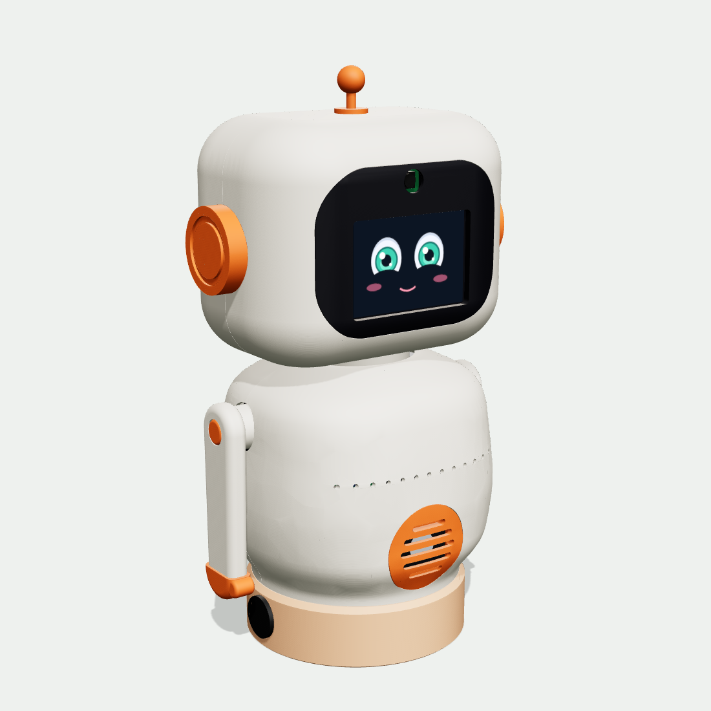

# C.U.T.Y · Carcasa V17 «Fijo»

La misma carcasa V17 sin movimiento en la base: el cuerpo termina plano y se para sobre un pedestal bajo. Solo se mueven la **cabeza** (±90°) y los **brazos** (±120°). Mide **31.6 cm** de alto, 4.9 cm menos que la [versión con nido](../carcasa_v17/LEEME.md). Tiene los mismos espacios para la placa C.U.T.Y, la Raspberry Pi 5, la batería y su cajón, el rack de potencia, la pantalla, la cámara, la bocina, el ReSpeaker y los dos interruptores. 27 piezas, todas caben en la cama de 180 × 180 mm de la Bambu A1 mini.



## Qué cambia respecto a la versión con gimbal

| | Con gimbal («Nido») | Fija |
|---|---|---|
| Base | Nido de Ø172 mm; el cuerpo se inclina ±15° con 2 servos | **Pedestal de Ø126 × 34 mm**; no se mueve |
| Altura | 36.5 cm | **31.6 cm** |
| Piezas | 30 | 27: sin cruceta G1 ni manivelas G2/G3 |
| B1–B4 | Cubierta, piso, cajón y poste con horquilla | Pedestal, piso del pedestal, cajón (batería a lo largo) y soporte de la plataforma |
| K1 | Plataforma con horquilla y patas | Plana por abajo, atornillada al soporte |
| S1, S2 | Con fondo de bola | Terminan planas justo debajo de la rejilla |
| Servos | 5 | 3 (J7 cabeza, J8 brazo izquierdo, J9 brazo derecho); J10 y J11 quedan libres |
| Compras | Rótulas Hobbypark y varilla roscada M3 | Ya no se necesitan |
| Tornillos | 2 × M4 × 30, 2 × M3 × 8 allen y los de las rótulas | 4 × M3 × 12 para el soporte y 4 × M3 × 10 para la plataforma |

Todo lo demás es idéntico: cabeza, brazos, núcleo (K2–K5), rejilla, tapón USB y toda la electrónica.

## Qué hay en esta carpeta

| Carpeta / archivo | Para qué sirve |
|---|---|
| `STL_imprimir/` | 27 STL listos para Bambu Studio, ya orientados para la cama. |
| `renders/` | Frente, espalda, lado y rayos X. |
| [`../carcasa_v17/fuente_cad/`](../carcasa_v17/fuente_cad) | El mismo generador en CadQuery que la versión con gimbal; la fija se construye con `CUTY_FIJO=1`. Su `export.py` saca también los STEP para Fusion y el modelo .glb. |
| `partes.json`, `verificacion.json` | Medidas de impresión, volúmenes y resultados de la revisión de choques. |

## Imprimir

Capa 0.2 mm, 3 perímetros, 15 % de relleno giroide, PLA. Holguras de encaje de 0.2 mm. Izquierda y derecha se leen viendo al robot de frente.

| Código | Pieza | Color | Medida en cama (mm) | Cómo imprimir |
|---|---|---|---|---|
| B1 | Pedestal | Durazno | 126 × 126 × 34 | **Boca abajo**, la tapa en la cama · sin soportes |
| B2 | Piso del pedestal | Gris | 119 × 119 × 10 | Plano · sin soportes |
| B3 | Cajón de batería | Durazno | 45 × 117 × 27 | Sobre el fondo · sin soportes |
| B4 | Soporte de la plataforma | Gris | 57 × 57 × 14 | Plano · sin soportes |
| K1 | Plataforma del núcleo | Gris | 124 × 118 × 8 | Plana, como va (los postes de la Pi hacia arriba) · sin soportes |
| K2 | Columna del núcleo | Gris | 110 × 96 × 10 | Acostada |
| K3 | Hombros | Gris | 114 × 32 × 66 | Viga abajo |
| K4 | Cubo del cuello | Gris oscuro | 32 × 32 × 14 | Brida abajo · 100 % relleno |
| K5 | Rack de potencia | Gris | 38 × 55 × 44 | De lado · soportes mínimos |
| S1 | Panza | Crema | 148 × 127 × 76 | Sobre la costura · soportes solo en los clips |
| S2 | Espalda | Crema | 148 × 127 × 64 | Sobre la costura · soportes solo en los clips |
| S3 | Rejilla de la panza | Naranja | 55 × 55 × 11 | Marco de la bocina abajo · soportes árbol solo bajo el anillo |
| S4 | Tapón USB | Naranja | 8 × 13 × 12 | Sobre su cara plana (la del tapón) |
| A1, A2 | Brazos | Crema | 104 × 30 × 22 | Cara exterior abajo · 4 perímetros |
| A3, A4 | Manos | Naranja | 16 × 34 × 14 | Cara exterior abajo |
| A5, A6 | Tapas de brazo | Naranja | 14 × 14 × 4 | Cara abajo |
| H1 | Casco frontal | Crema | 160 × 134 × 56 | Sobre la costura · soportes árbol mínimos |
| H2 | Casco trasero | Crema | 160 × 134 × 56 | Sobre la costura (el nombre queda arriba) |
| H3 | Visor | Negro | 121 × 93 × 11 | Cara abajo en PEI texturizado · soportes en las orillas |
| H4 | Barras de la pantalla y de la cámara | Gris | 85 × 87 × 3 | Planas (3 barras) |
| H5 | Base de la cabeza | Gris | 96 × 48 × 10 | Plana |
| H6, H7 | Orejas | Naranja | 46 × 46 × 22 | Cara exterior abajo |
| H8 | Antena | Naranja | 18 × 18 × 34 | De pie · soporte bajo la bolita |

Los STL de la panza, la espalda, la plataforma y las cuatro piezas de la base llevan `_Fixed` o `Pedestal`/`Riser` en el nombre para que no se confundan con las de la versión con gimbal.

Filamento aproximado (PLA, 15 % de relleno): crema ≈ 350 g, gris ≈ 170 g, durazno ≈ 90 g, naranja ≈ 50 g, negro ≈ 25 g, gris oscuro ≈ 6 g. Total ≈ 0.7 kg.

**Primero imprime una prueba:** K4 (cubo del cuello). Si el spline de 25 dientes de tu MG996R entra muy duro o muy flojo, ajusta `spline_25t` en `../carcasa_v17/fuente_cad/v17/common.py` y reconstruye.

## Tornillería

Todo sale de dos kits: **Taiss** (autorroscantes de cabeza redonda M2 y M3) y el **kit M3 allen**. Los autorroscantes van en plástico; los allen van en el eje metálico de los servos.

| Cant. | Tornillo | Kit | Dónde |
|---|---|---|---|
| 24 | M3 × 10 autorroscante | Taiss | 8 en los servos de los brazos · 4 plataforma al soporte · 4 rack a la columna del núcleo · 4 base de la cabeza · 4 servo de cabeza |
| 7 | M3 × 8 autorroscante | Taiss | 4 placa C.U.T.Y a la columna del núcleo · 3 cubo del cuello a la viga |
| 8 | M3 × 12 autorroscante | Taiss | 4 soporte al pedestal · 2 columna del núcleo a la plataforma · 2 hombros a la columna del núcleo |
| 4 | M2 × 8 autorroscante | Taiss | Raspberry Pi 5 |
| 6 | M2 × 10 autorroscante | Taiss | 4 barras de la pantalla · 2 barrita de la cámara |
| 2 | M3 × 12 allen | Kit M3 | Brazos a sus servos |
| 1 | M3 × 20 allen | Kit M3 | Desde abajo de la viga al servo de la cabeza |

Además: 4 topes de silicón bajo el piso. Opcional: una cinta de velcro de 20 mm por las dos ranuras del cajón para sujetar la batería.

## Piezas compradas para las que está diseñada

| Pieza | Medida que usa el modelo |
|---|---|
| Batería LiPo 3S 2200 mAh 50C (HM2202, la del equipo) | va **a lo largo**, cables hacia el frente; el cajón acepta hasta 109 × 35 × 25 mm |
| Buck XL4015 5 A (sin voltímetro) | 54 × 23 × 18 mm, de pie, bornes arriba |
| Convertidor JRBLVL 12→5 V 5 A, USB-C en cable | 46 × 32 × 18 mm, de pie, cables hacia abajo |
| 2 balancines redondos 12 V/20 A | agujero Ø20 mm a los lados del pedestal |
| Cable de cámara Pi 5, 22→15 pines, 50 cm | pasa por la ranura trasera de la viga |
| Cable plano IDC de 40 vías hembra-hembra, 20 cm | J12 → Pi 5, por el lado derecho de la columna del núcleo |
| Extensión XT60 macho-hembra, 30 cm | batería → J1: el XT60 queda en la bahía izquierda del pedestal y la extensión sube por el hueco izquierdo del pedestal y de la plataforma |
| Cable de silicón 16 AWG | J2/J3 → interruptores (35 cm por cable) y J4/J5 ↔ buck (15 cm por cable) |
| Raspberry Pi 5 | 90.3 × 56 × 18 mm medida (con puertos y micro SD) |
| Pantalla Display-G 3.5" | 85 × 55.3 × 5.8 mm medida |
| ReSpeaker 2-Mics HAT V2.0 | 65.5 × 29.8 × 11.5 mm medida |
| Cámara Arducam OV5647 | PCB 24.4 × 23.3 mm, 7.2 mm de fondo |
| Bocina 2 W 8 Ω | 35.4 × 25 × 5.5 mm medida, va acostada |
| 3 × MG996R | 40.7 × 19.7 × 37 mm (sin brackets ni placas de metal) |

## Armado en 12 pasos

1. **Pedestal.** Interruptores a presión en los agujeros de los lados (principal a la izquierda, servos a la derecha) y sus cables hacia arriba por los dos huecos de la tapa. Pasa también la extensión XT60 por el hueco izquierdo, con el conector que va a la batería abajo. Asienta el soporte B4 sobre la tapa con sus 4 agujeros con caja encima de los de la tapa y atorníllalo desde arriba con 4 × M3 × 12.
2. **Piso.** Pega los 4 topes de silicón por abajo y deja el piso en la mesa. Baja el pedestal girado 14° en sentido antihorario (visto desde arriba) para que entren las 4 pestañas y gíralo 14° en sentido horario hasta que la abertura del cajón quede sobre los rieles del piso.
3. **Plataforma y columna del núcleo (en la mesa).** Columna en la ranura de la plataforma con 2 × M3 × 12 desde abajo. Asienta la plataforma sobre el soporte, pasando los cables por los huecos de sus lados, y atorníllala desde arriba con 4 × M3 × 10. Los dos de atrás quedan bajo la Pi, por eso van antes que ella.
4. **Placa C.U.T.Y.** En los 4 postes del frente de la columna (M3 × 8).
5. **Raspberry Pi 5.** En los postes detrás de la columna (4 × M2 × 8). Conecta el cable plano de 40 vías a J12 y a la Pi.
6. **Rack de potencia.** XL4015 contra la columna (bornes arriba), convertidor de 5 V de pie en su repisa con sus cables hacia abajo por la ranura, rack a la columna con sus 4 orejas (M3 × 10). El USB-C del convertidor va a la Pi.
7. **Hombros y cuello.** Servos de brazo desde adentro (8 × M3 × 10), hombros arriba de la columna (2 × M3 × 12), cubo del cuello sobre la viga (3 × M3 × 8).
8. **Visor.** Pantalla de cara contra el visor dentro de sus costillas, dos barras (4 × M2 × 10). Cámara desde arriba entre sus dos guías, con el lente hacia la ventana redonda y el cable hacia abajo; la barrita la aprieta por detrás (2 × M2 × 10).
9. **Cabeza.** Servo de cabeza en su base (4 × M3 × 10). Visor dentro del casco frontal, cierra con el trasero, presiona orejas y antena. 4 × M3 × 10 desde abajo. Monta la cabeza en el cubo y fija con M3 × 20 allen desde abajo de la viga. Deja una vuelta de cable de cámara y de Dupont para que la cabeza gire ±90°.
10. **Panza y espalda.** Bocina acostada en el bolsillo de la rejilla, cara hacia afuera, con 2 o 3 puntos de silicón; rejilla en la panza. Desliza panza y espalda sobre el pedestal hasta que los clips muerdan la plataforma. Tapón USB.
11. **Brazos.** Cada brazo por su agujero hasta el spline (M3 × 12 allen), tapas y manos a presión. Los brazos cierran el cuerpo.
12. **Batería.** Batería en el cajón a lo largo, con los cables hacia el frente. Conéctala a la extensión XT60, acomoda el conector en la bahía izquierda y desliza el cajón hasta que caiga en su tope. Enciende el principal y luego el de servos. Para cargarla, saca el cajón por atrás: la extensión trae holgura para desconectar el XT60 afuera.

Servos en la placa: J7 cabeza, J8 brazo izquierdo, J9 brazo derecho. J10 y J11 quedan vacíos; el sketch de centrado de la guía funciona igual.

## Límites de movimiento (ponlos en el firmware)

| Eje | Límite verificado |
|---|---|
| Giro de cabeza | ±90° |
| Brazos | ±120° |

## Verificación (13 nov 2026)

- 27 piezas, cada una un sólido válido; STL herméticos y con una cara plana en la cama (el pedestal apoya toda su tapa: 10 580 mm²).
- Todas caben en 180 × 180 × 180 mm (la más grande es la cabeza: 160 × 134).
- 109 cuerpos (27 impresos y 82 comprados, incluidos los 8 tornillos de la plataforma y el soporte) revisados por pares con todo armado: 0 interferencias exactas. Las cabezas de los tornillos de la plataforma quedan 2.6 mm debajo de la Raspberry Pi.
- Pedestal: 190 pares revisados con intersección exacta (batería, cables, XT60, interruptores y tornillos incluidos), sin choques. El cajón sale 130 mm por atrás sin tocar nada; al cerrar sube 0.3 mm sobre dos topes y cae en su lugar. La bayoneta gira libre hasta su entrada y trabada no se levanta. Panza y espalda se deslizan sin tocar el pedestal.
- 18 zonas para cables y conectores libres de plástico, igual que la versión con gimbal.
- 22 posturas revisadas (cabeza a ±30/60/90° y cada brazo a ±30/60/90/120°): sin choques. Los brazos pasan por fuera del pedestal y las manos quedan a 32 mm de la mesa.
- Largos de cable: extensión XT60 ≈20 de sus 30 cm, interruptores ≈19 cm de los 35, el resto igual que la versión con gimbal.

## Antes de imprimir todo

Falta medir la batería (largo × ancho × alto). El modelo supone 108 × 35 × 25 mm y el cajón acepta hasta 109 × 35 × 25. Si es más alta, el pedestal crece lo mismo: cambia `BATT` en `../carcasa_v17/fuente_cad/v17/refs.py` y reconstruye.

## Reconstruir

```
cd hardware/cad/carcasa_v17/fuente_cad/v17
pip install cadquery==2.8.0 trimesh manifold3d
CUTY_FIJO=1 python3 build.py --rebuild     # reconstruye las piezas de la versión fija
CUTY_FIJO=1 python3 meshcheck.py           # choques en reposo y al mover cabeza y brazos
CUTY_FIJO=1 python3 pedcheck.py            # pedestal: pares exactos, cajón, bayoneta
CUTY_FIJO=1 python3 export.py              # paquete CUTY_V17_Fijo: STL, STEP y .glb
```

Sin `CUTY_FIJO=1` los mismos comandos construyen la versión con gimbal.
