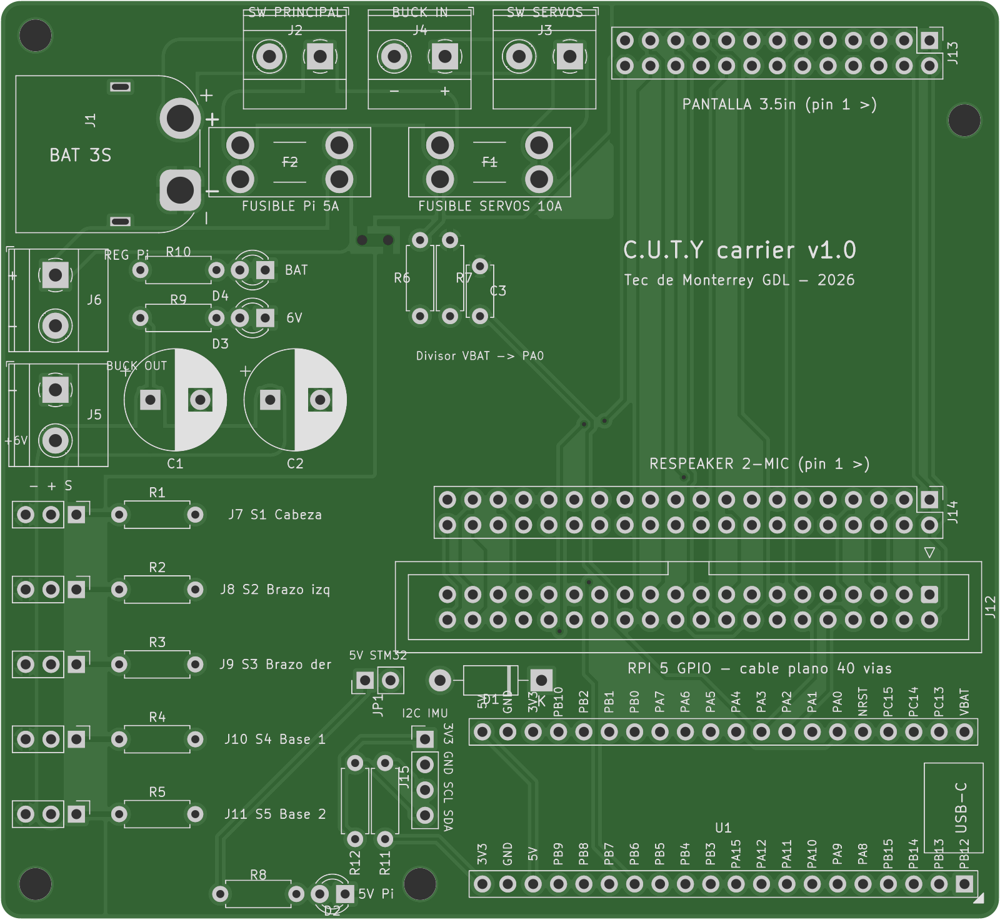

# C.U.T.Y — Placa base (carrier) v1.0

PCB de 2 capas que reemplaza la protoboard y los cables Dupont. Interconecta
la Raspberry Pi 5, la STM32F401 Black Pill, la pantalla Display-G de 3.5 in,
el ReSpeaker 2-Mics Pi HAT V2.0 y los cinco MG996R, y distribuye la energía
de la LiPo 3S. Todos los módulos van enchufados (cable plano, zócalos y
tiras de pines), así que se pueden quitar o reemplazar.

| | |
| --- | --- |
| Tamaño | 100 × 92 mm, esquinas redondeadas, 4 barrenos M3 |
| Capas | 2 (F.Cu / B.Cu), FR-4 1.6 mm |
| Componentes | 100 % de agujero pasante (THT), fáciles de soldar a mano |
| Pista / espacio mínimo | 0.30 mm / 0.25 mm (señales); 2.5–3.0 mm en potencia |
| Taladro mínimo | 0.40 mm (vías) |
| DRC | 0 errores eléctricos, 0 pads sin conectar (`drc_report.txt`) |



## Pedido en PCBWay

1. Sube **`CUTY_carrier_PCBWay_gerbers.zip`** en *PCB Instant Quote → Quick-order PCB*.
   PCBWay detecta el tamaño (100 × 92 mm) y las 2 capas.
2. Opciones:
   - Material FR-4, TG130 · Espesor 1.6 mm · Capas 2
   - Pista/espacio mínimos 6/6 mil · Taladro mínimo 0.3 mm (cualquier valor estándar sirve)
   - Acabado HASL lead free · Máscara verde · Serigrafía blanca
   - **Cobre: 1 oz** basta para uso normal. **Si los 5 servos van a forzar a la vez, pide 2 oz.**
     Las pistas de batería son de 3 mm y el bus de 6 V va en ambas capas.
   - Cantidad: 5 (el mínimo)
3. No hace falta ensamblado: todo es THT. La lista de compras está en `fab/cuty_carrier_BOM.csv`.

## Qué hay en la placa

**Energía** (bornes en el borde superior e izquierdo):

```
LiPo 3S ─ J1 XT60 ─ J2 interruptor general ─┬─ F1 10 A ─ J3 interruptor servos ─ J4 → buck → J5 6 V ─ C1/C2 ─ servos
                                            └─ F2 5 A ─ J6 → regulador 5.1 V / 5 A ─ USB-C ─ Raspberry Pi 5
```

- **J2 y J3** son bornes para interruptores de panel externos de al menos 10 A.
- **Tierras.** PGND (potencia: batería, buck, servos) y GND (lógica: Pi,
  STM32, audio, pantalla) son dos planos separados. Solo se unen en **NT1**,
  junto a la entrada de batería. Así la corriente de los servos no regresa
  por la tierra del audio ni de la lógica.
- **Rieles.** La Pi recibe su energía por USB-C desde el regulador, como pide
  la especificación. La pantalla y el ReSpeaker toman 5 V y 3.3 V de los
  pines de la Pi, como cuando estaban montados sobre ella. La 3.3 V y la 5 V
  nunca se tocan.
- **STM32.** Toma 5 V de la Pi a través de **JP1** (jumper) y **D1** (1N5819).
  D1 evita que el USB de la Black Pill alimente de regreso a la Pi. Quita el
  jumper si quieres alimentar la STM32 solo por USB mientras la programas.
  La 3.3 V de la Black Pill (`+3V3_BP`) es independiente de la 3.3 V de la Pi.
- **LEDs.** BAT (rojo), 6V (azul) y 5V Pi (verde).

**Señales**

| Origen | Destino | Nota |
| --- | --- | --- |
| Pi pin 8 (TX) | PA3 USART2_RX | Cruzado |
| Pi pin 10 (RX) | PA2 USART2_TX | |
| PB6 / PB7 / PB8 / PB9 | Servos 1–4 (J7–J10) | TIM4 CH1–CH4, 220 Ω en serie |
| PA8 | Servo 5 (J11) | TIM1 CH1, 220 Ω en serie |
| PA0 | Divisor de batería | V<sub>bat</sub> = V<sub>ADC</sub> × 122 / 22 (12.6 V → 2.27 V) |
| PB10 / PB3 | J15 I2C2 (SCL/SDA) | Para la IMU futura, con pull-ups de 4.7 kΩ |
| J12 ↔ J13 | Pantalla | Pines 1, 2, 4, 6, 11, 17–26 y GND, numeración física idéntica a la Pi |
| J12 ↔ J14 | ReSpeaker | Pines 1–7, 12, 17, 35, 37, 38, 40 y GND. Quedan libres 8, 10, 11, 19, 23, 32, 33 y los demás |

Cada servo usa el orden estándar **– + S** (marrón, rojo, naranja). El
negativo queda hacia el borde de la placa.

## Antes de soldar y conectar (revisar sí o sí)

1. **Orientación de la Black Pill.** El footprint usa el pinout WeAct V1.2/V3.0:
   la fila PB12…3V3 y la fila VBAT…5V, con el USB-C hacia el borde derecho y los
   componentes hacia arriba. Imprime `fab/cuty_carrier_capa_superior.pdf` a
   escala 1:1, pon tu módulo encima y confirma que las etiquetas coinciden.
   Si las filas resultaran al revés, el módulo funciona volteado (componentes
   hacia la placa); no hace falta rehacer la PCB.
2. **Ajusta el buck a 6.0 V con el multímetro antes de conectarlo a J5.**
3. **Polaridad.** Revisa la polaridad del XT60: el pad de arriba es **+**. La
   PCB lleva el XT60 **macho**; la batería debe tener XT60 hembra.
4. **Cable plano.** El cable a la Pi debe ser recto, de pin 1 a pin 1 (hilo
   rojo al pin 1). La flecha ▽ marca el pin 1 en J12.
5. **Pantalla y ReSpeaker.** Se insertan como sobre la Pi: el pin 1 está a la
   derecha (cuadro). El cuerpo de la pantalla sale por el borde superior. El
   ReSpeaker queda sobre el área de pistas, donde solo hay componentes bajos.
6. **UART.** En la Pi 5 activa la UART de GPIO14/15 (`dtparam=uart0=on` en
   `config.txt`) y valida el enlace antes de dar el diseño por definitivo.
7. **Batería.** La placa solo protege con fusibles. La LiPo sigue necesitando
   una alarma o BMS de sobredescarga y un cargador balanceador 3S.

## Archivos

| Archivo | Qué es |
| --- | --- |
| `cuty_carrier.kicad_pro/.kicad_sch/.kicad_pcb` | Proyecto KiCad 7, abre en KiCad 7, 8 y 9 |
| `CUTY.kicad_sym`, `CUTY.pretty/` | Símbolo y footprint propios de la Black Pill (tablas de bibliotecas incluidas) |
| `fab/gerbers/` | Gerbers RS-274X y taladros Excellon (PTH y NPTH separados) |
| `fab/cuty_carrier_BOM.csv` | Lista de materiales |
| `fab/cuty_carrier_esquematico.pdf` | Esquemático |
| `fab/preview/` | Render de los Gerbers (como saldrá fabricada) |
| `drc_report.txt` | Reporte DRC |
| `scripts/` | Generadores: el diseño completo se reconstruye desde `netlist.py` |

### Regenerar el diseño

Requisitos: KiCad 7+, Python con `sexpdata`, Java 21 y el `.jar` de Freerouting.

```sh
cd scripts
python3 netlist.py                      # verifica la tabla de conexiones
python3 gen_lib.py && python3 gen_sch.py
/usr/bin/python3 gen_pcb.py             # Python de KiCad (pcbnew)
/usr/bin/python3 route.py freerouting.jar 60   # o "reuse" para reusar _route/board.ses
/usr/bin/python3 verify_pcb.py          # paridad pad por pad con netlist.py
```

`netlist.py` es la única fuente de verdad: si cambias una conexión ahí,
el esquemático y la PCB salen iguales.
