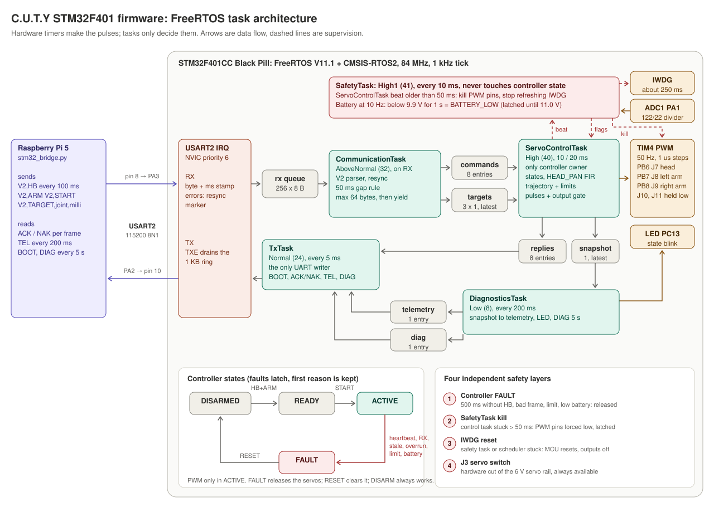

# C.U.T.Y STM32F401 firmware

FreeRTOS firmware for the STM32F401CC Black Pill on the [carrier PCB v1.1](../hardware/electronics/kicad/cuty_carrier/README.md).
It receives high-level goals from the Raspberry Pi over USART2 and owns trajectories,
limits, PWM and safety for HEAD_PAN (J7), LEFT_ARM (J8) and RIGHT_ARM (J9). J10 and J11
are reserved and held low.



```bash
make            # dry-run image (PWM pins never enabled): build/f401/cuty.bin
make PWM=1      # image that drives the servos after HB + ARM + START
make test       # host unit tests + FreeRTOS simulator scenario
make test-qemu  # boot the ARM image in QEMU and talk to it over USART2
make flash-dfu  # Black Pill DFU: hold BOOT0, tap NRST, release BOOT0
```

Architecture, protocol, safety layers, measured timings and the step-by-step bring-up
are in [docs/freertos-motion-control.md](../docs/freertos-motion-control.md). Hardware
validation is still pending: start with the dry-run image and the servo switch J3 off.

| Folder | Contents |
| --- | --- |
| `App/` | Portable logic, no registers: V2 parser and records, controller and FIR, safety, battery, liveness, servo calibration, CMSIS-RTOS2 task adapter |
| `App/board/cuty_board.h` | The only interface between the tasks and hardware |
| `Core/` | Black Pill support: clocks, USART2, TIM4, ADC, IWDG, LED, `main.c`, CMSIS-RTOS2 layer on FreeRTOS, FreeRTOS config, linker script |
| `sim/` | Same tasks on the FreeRTOS POSIX port, UART on stdin/stdout |
| `tests/` | Host unit tests, simulator scenario, QEMU test, ARM object check |
| `Drivers/`, `Middlewares/` | Vendored CMSIS 6.1, ST cmsis_device_f4 2.6.10, FreeRTOS-Kernel V11.1.0 ([THIRD_PARTY.md](THIRD_PARTY.md)) |
| `tools/` | Diagram generator |
